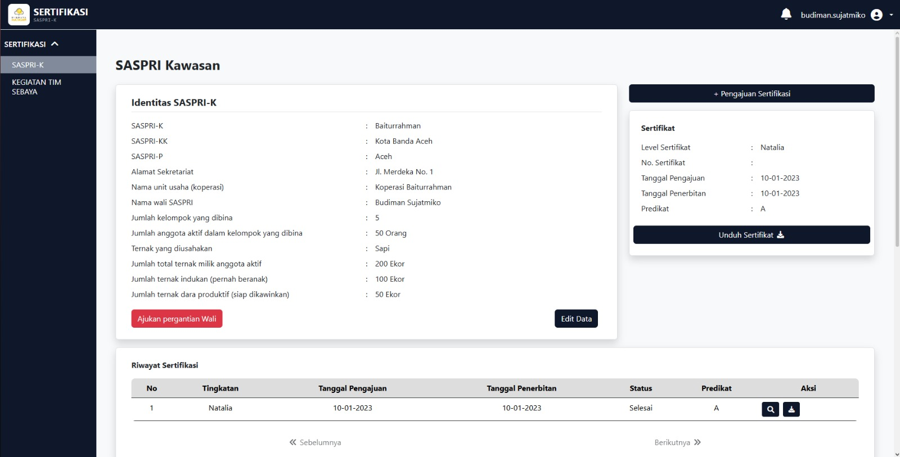
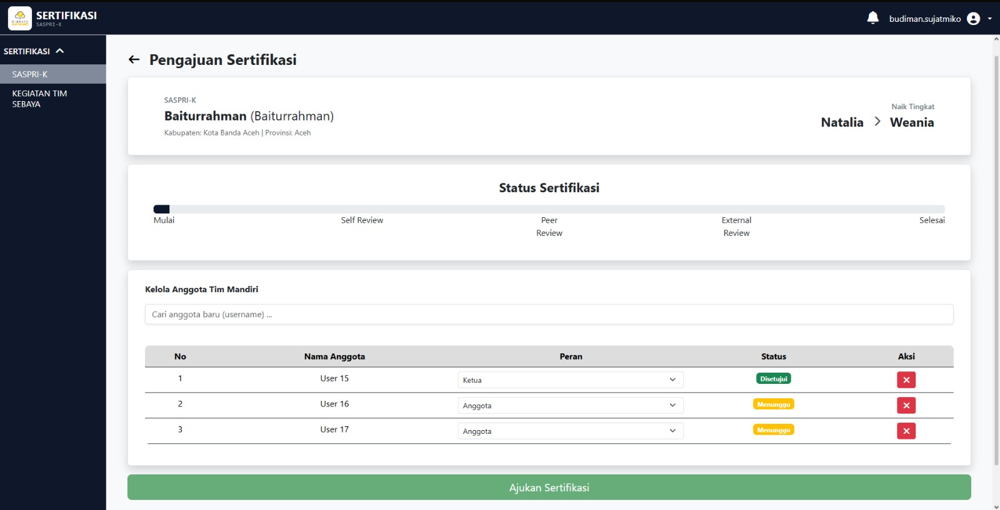
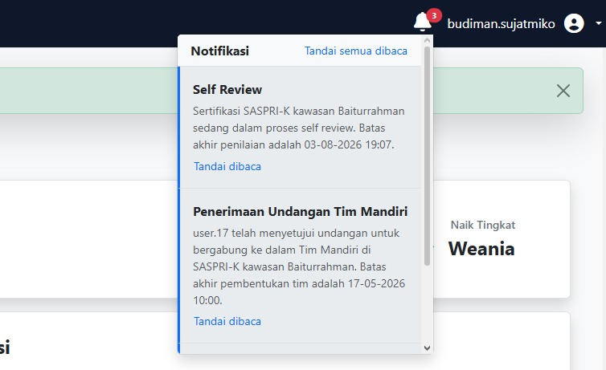
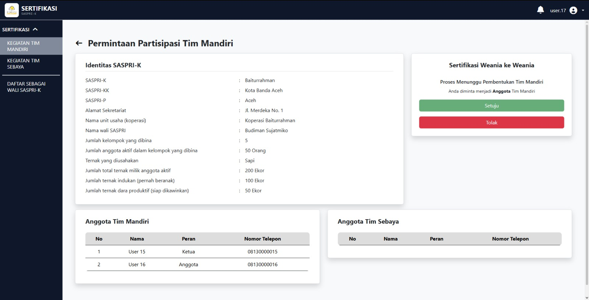
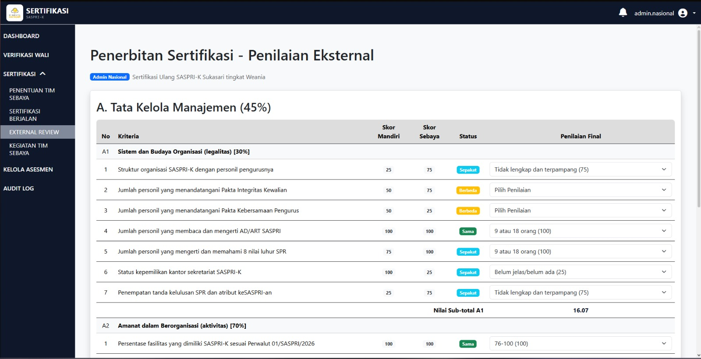
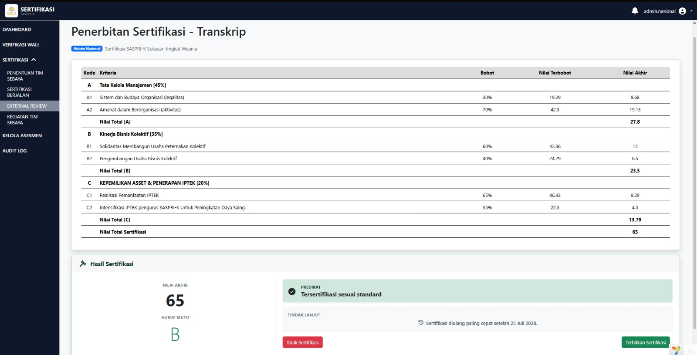
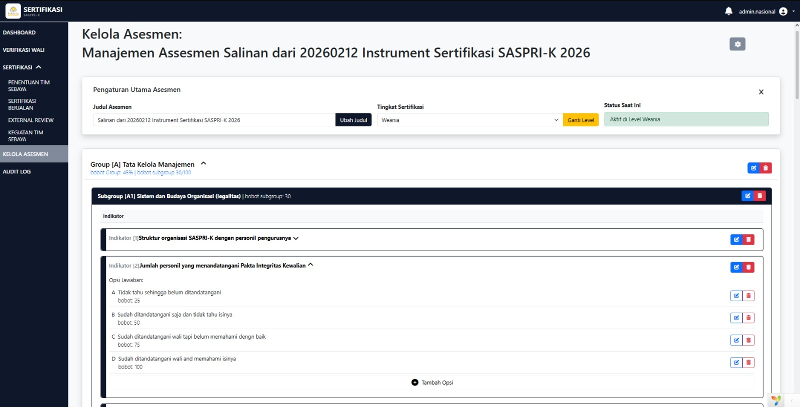

<p align="center">
    
</p>

<p align="center">
  <em>Digitize livestock certification workflows, centralize compliance documentation, and streamline multi-tier verification.</em>
</p>

<p align="center">
  <a href="https://sertifikasi.digdaya.net/">
    <strong>🌐 Visit SASPRI Certification System</strong>
  </a>
</p>

<p align="center">
  
  &nbsp;&nbsp;
  
  &nbsp;&nbsp;
  
  &nbsp;&nbsp;
  
  &nbsp;&nbsp;
  
</p>

## 🚀 Core Features

- **Multi-Tier Certification Workflow:** Supports Self-Review (*Tim Mandiri*), Peer Review (*Tim Sebaya*), and External Review by SASPRI National.
- **Centralized Document & Evidence Management:** Provides a centralized repository for certification documents and supporting evidence.
- **Role-Based Access Control (RBAC):** Manages access permissions for administrators, reviewers, coordinators, and other authorized stakeholders.
- **RESTful API:** Exposes certification, assessment, indicator, team management, user, regional, and notification endpoints for application integration.
- **Asynchronous Queue & Notifications:** Processes background jobs for automated notifications and other time-consuming tasks.
- **Automated PDF Certificate Generation:** Generates digital certification documents from verified assessment and certification data.

## 💡 Key Highlights & Engineering Impact

The **Saspri Certification System** modernizes agricultural certification operations while emphasizing data integrity, maintainability, and reliable business process execution.

- **Centralized and Traceable Certification Records:** Replaces fragmented document management across spreadsheets, WhatsApp groups, and separate storage locations with a centralized repository that improves document accessibility and traceability.
- **Structured and Transparent Review Process:** Standardizes the three-stage certification lifecycle, making review progression and certification status easier to track across participating teams and SASPRI National.
- **Reduced Manual Administrative Work:** Automates background notifications and PDF certificate generation, reducing repetitive administrative tasks and manual coordination.
- **Strict Data Integrity & Validation:** Combines ActiveRecord validation, custom behaviors, enums, and database-level constraints to maintain data consistency and protect multi-step certification state transitions through database transactions.
- **Reusable Service Layer Architecture:** Extracts business logic into dedicated service classes under `common/services/`, separating domain operations from controllers while enabling the same business logic to be reused by both web and REST API controllers.
- **Consistent Access Control & Data Isolation:** Enforces role-based permissions and backend authorization to ensure users can access only the operations and records permitted by their roles.

## 🛠️ Architecture & Technology Stack

The project is structured around a multi-tier PHP architecture ensuring high maintainability, testability, and security.

### Backend & Core Framework

- [**Yii 2 Framework**](https://www.yiiframework.com/): Chosen for its high performance, rich component-based architecture, and out-of-the-box security defenses against SQL injection, XSS, and CSRF.
- [**Bootstrap 5 & Bootstrap Icons**](https://getbootstrap.com/): Powers a clean, responsive, and accessible user interface across both admin and participant portals.
- [**Kartik-v mPDF**](https://github.com/kartik-v/yii2-mpdf): Generates pixel-perfect PDF documents and official certification files directly from HTML/CSS templates.
- [**Firebase Cloud Messaging (FCM)**](https://firebase.google.com/docs/cloud-messaging): Enables push notifications to deliver certification updates and important information to users.
- [**Yii2 Queue**](https://github.com/yiisoft/yii2-queue): Manages background worker jobs for asynchronous email notifications and system maintenance.

### Code Quality & Testing

- **PHP 8.5+:** Utilizes modern PHP typing, error handling, and performance optimizations.
- **Codeception & PHPUnit:** Comprehensive test suites covering unit, functional, and acceptance testing across common, backend, and frontend modules.

## 📁 Repository Structure

The project follows the strict separation of concerns mandated by the Yii 2 Advanced Project Template, enhanced with custom service and job layers:

```text
sertifikasi-saspri/
├── common/                  # Shared components across frontend, backend, & console
│   ├── behaviors/           # Reusable ActiveRecord behaviors
│   ├── config/              # Shared application configurations
│   ├── enums/               # Application-wide enumerations and status definitions
│   ├── fixtures/            # Test data fixtures
│   ├── helpers/             # Utility and formatting helpers
│   ├── jobs/                # Background queue job handlers (Yii2-Queue)
│   ├── mail/                # Email view templates
│   ├── models/              # Shared database models and business logic
│   ├── services/            # Dedicated domain service layers
│   ├── tests/               # Common test suites
│   ├── widgets/             # Shared UI widgets
│   └── codeception.yml      # Codeception configuration for common tests
│
├── backend/                 # Administrative Web Application (SASPRI National & Management)
│   ├── assets/              # Backend CSS/JS assets
│   ├── config/              # Backend routing and component configs
│   ├── controllers/         # Admin request controllers
│   ├── models/              # Backend-specific form models
│   ├── views/               # Admin panel view files
│   └── web/                 # Backend entry script (index.php)
│
├── frontend/                # Participant & Reviewer Web Portal (Tim Mandiri & Tim Sebaya)
│   ├── assets/              # Frontend CSS/JS assets
│   ├── config/              # Frontend routing configs
│   ├── controllers/         # Portal controllers
│   │   ├── api/             # REST API controllers
│   │   ├── *Controller.php  # Web request controllers
│   ├── models/              # Portal user models & forms
│   ├── views/               # Portal view files
│   ├── widgets/             # Frontend-specific widgets
│   └── web/                 # Frontend entry script (index.php)
│
├── console/                 # Command Line Application & Background Workers
│   ├── controllers/         # Console CLI commands
│   ├── migrations/          # Database migration files
│   └── config/              # Console configurations
│
├── docs/                    # Documentation and setup guides
│
├── environments/            # Environment-specific configuration overrides
├── vendor/                  # Composer dependencies
└── composer.json            # Project dependencies and PHP requirements
```

## 🚀 Installation

This document provides step-by-step instructions for setting up the SASPRI Certification System locally using Laragon.

### 📋 Prerequisites

Ensure your local development environment has the following installed:

- Laragon (PHP ^8.4.1, MySQL, Nginx)
- Composer
- Git

### 🛠️ Step-by-Step Setup

#### 1. Clone the Repository

Open your Laragon terminal and run:

```bash
git clone <URL_REPOSITORY> saspri-app
cd saspri-app
```

Replace `<URL_REPOSITORY>` with your actual repository URL.

#### 2. Install Dependencies

Install all required application dependencies:

```bash
composer install
```

#### 3. Initialize the Yii2 Project

Run the following command:

```bash
php init
```

Then select:

- `0` → Development Environment
- `yes` → Confirm initialization

This will generate local configuration files such as:

- `common/config/main-local.php`
- `frontend/config/main-local.php`
- `backend/config/main-local.php`

#### 4. Setup Laragon Web Server (Virtual Host & HTTPS)

**Laragon Virtual Host Setup**

To access the application using `.test` domains, create symbolic links from the Yii2 web folders to Laragon's `www` directory.

Run Command Prompt as Administrator:

**Frontend**

```cmd
mklink /D "C:\laragon\www\frontend" "C:\path\to\project\frontend\web"
```

**Backend**

```cmd
mklink /D "C:\laragon\www\backend" "C:\path\to\project\backend\web"
```

**Example**

If your project is located at:

```text
D:\Projects\saspri-app
```

Run the following commands:

```cmd
mklink /D "C:\laragon\www\frontend" "D:\Projects\saspri-app\frontend\web"
mklink /D "C:\laragon\www\backend" "D:\Projects\saspri-app\backend\web"
```

**HTTPS Configuration for FCM (Laragon)**

Firebase Cloud Messaging on web browsers requires the application to run over HTTPS.

1. Open Laragon.
2. Go to:

   `Menu → SSL → Add laragon.crt to Trust Store`

   Run this step if the Laragon certificate has not been added to your Windows Trust Store yet.

3. Enable SSL:

   `Menu → SSL → Enabled`

4. Restart Laragon.

Once SSL is active, access the app via:

- [https://frontend.test:8443](https://frontend.test:8443)
- [https://backend.test:8443](https://backend.test:8443)

Ensure the SSL port in Laragon's Nginx configuration is set to `8443`. If using default ports, omit `:8443` from the URL.

Browser push notifications will not work without HTTPS.

#### 5. Configure `main-local.php` (Database & SMTP)

**Create Database**

Using HeidiSQL, phpMyAdmin, or any database management tool, create a new database:

```sql
CREATE DATABASE sertifikasi_saspri;
```

**Setup Gmail SMTP**

The application uses SMTP for transactional emails and account-related notifications.

If using Gmail:

1. Enable Two-Factor Authentication (2FA) on your Google account.
2. Navigate to Google App Passwords.
3. Generate a new App Password.
4. Use the generated App Password as your password value.

Do not use your regular Gmail login password; it will not work for SMTP authentication.

**Update Configuration**

Open:

`common/config/main-local.php`

Update the configuration as follows:

```php
return [
    'components' => [
        'db' => [
            'class' => \yii\db\Connection::class,
            'dsn' => 'mysql:host=localhost;dbname=sertifikasi_saspri',
            'username' => 'root',
            'password' => '',
            'charset' => 'utf8mb4',
        ],
        'mailer' => [
            'class' => \yii\symfonymailer\Mailer::class,
            'viewPath' => '@common/mail',
            'useFileTransport' => false,
            'transport' => [
                'scheme' => 'smtps',
                'host' => 'smtp.gmail.com',
                'username' => '{{ YOUR_EMAIL_ADDRESS }}',
                'password' => '{{ 16_CHARACTER_GMAIL_APP_PASSWORD_WITHOUT_SPACES }}',
                'port' => 465,
            ],
        ],
    ],
];
```

#### 6. Configure `params-local.php` (Global Params & Firebase)

The application uses Firebase Cloud Messaging (FCM) for push notifications.

Open:

`common/config/params-local.php`

Update the configuration:

```php
return [
    'frontendUrl' => 'https://frontend.test:8443',
    'firebase' => [
        'apiKey' => '',
        'authDomain' => '',
        'projectId' => '',
        'storageBucket' => '',
        'messagingSenderId' => '',
        'appId' => '',
        'vapidKey' => '',
    ],
    'supportEmail' => 'email@example.com',
    'senderEmail' => 'email@example.com',
];
```

**Notes:**

- All Firebase configuration values can be retrieved from the Firebase Console.
- `supportEmail` and `senderEmail` are used as system email sender addresses.
- It is recommended to use the same email address configured in SMTP username.

#### 7. Setup Firebase Service Account

Save your Firebase Service Account credentials JSON file to:

```text
common/config/firebase-credentials.json
```

This file is used by the backend to authenticate with Firebase when dispatching push notifications.

Do not commit `firebase-credentials.json` to version control as it contains sensitive credentials.

#### 8. Configure Console URL Manager

Open:

`console/config/main-local.php`

Add the following configuration:

```php
return [
    'components' => [
        'urlManager' => [
            'hostInfo' => 'https://frontend.test:8443',
        ],
    ],
];
```

#### 9. Database Migration and Seeding

Run the following commands:

```bash
php yii migrate
php yii db/seed
```

#### 10. Running the Queue Worker

The application uses Yii Queue to process asynchronous tasks, such as push notifications.

In local development, run the queue worker manually using:

```bash
php yii queue/listen
```

This command will keep running and process incoming queue jobs.

### Default Login Accounts

All accounts generated via the seeder use the default password:

```text
password_0
```

This password applies to all user roles:

- Admin SASPRI-N (`admin`)
- Coordinator SASPRI-K (`coordinator`)
- User SASPRI-K (`user`)

## 📚 Related Documentation

- [Yii 2 Framework Documentation](https://www.yiiframework.com/doc/guide/2.0/en) — Core framework and application architecture.
- [Bootstrap 5 Documentation](https://getbootstrap.com/docs/5.3/) — Responsive UI components and styling.
- [mPDF Documentation](https://mpdf.github.io/) — PDF certificate generation.
- [Firebase Admin SDK for PHP](https://firebase-php.readthedocs.io/) — Firebase integration and push notifications.

## 🖥️ Screenshots

1. Farm Profile


2. Certification Application Status



3. Invitation Notifications



4. Invitation Preview



5. Farm Assessment



6. Certificate Issuance



7. Assessment Management

